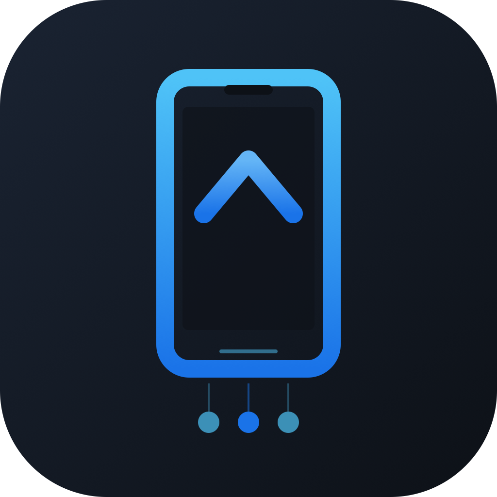

# Tempero Deploy

<p align="center">
  
</p>

<p align="center">
  <strong>Instale apps e jogos no iPhone direto do Mac — sem App Store, sem Jailbreak.</strong>
</p>

<p align="center">
  
  
  
</p>

---

## O que faz

O **Tempero Deploy** é um app desktop (macOS) que permite:

- **Projetos Swift** — compilar, assinar e instalar apps Swift no iPhone via USB
- **Arquivos IPA** — instalar qualquer arquivo `.ipa` no iPhone (jogos, apps)
- **Gerenciamento** — ver dispositivos conectados, histórico de projetos e IPAs

Tudo acontece localmente no seu Mac — os apps são assinados com o seu Apple ID gratuito e transferidos por USB.

---

## Pré-requisitos

Antes de usar o Tempero Deploy, você precisa instalar algumas coisas:

### 1. Xcode Command Line Tools

```bash
xcode-select --install
```

### 2. Swift (já vem com o Xcode CLI)

Verifique:

```bash
swift --version
```

### 3. xtool (substituto do Xcode para sideloading)

O **xtool** é a ferramenta que compila, assina e instala os apps no iPhone.

```bash
# Instalar via Homebrew
brew install xtool-org/tap/xtool

# Ou compilar do código-fonte
git clone https://github.com/nicklama/xtool.git
cd xtool
swift build -c debug
# O binário fica em .build/debug/xtool
```

### 4. Apple ID (gratuito)

Você precisa de um Apple ID para assinar os apps. Pode ser uma conta gratuita — não precisa pagar $99/ano do Apple Developer Program.

Faça login no xtool:

```bash
xtool auth
```

Siga as instruções para entrar com seu Apple ID e aceitar os termos de desenvolvedor.

### 5. Node.js (versão 18 ou superior)

```bash
# Instalar via Homebrew
brew install node

# Ou via nvm
curl -o- https://raw.githubusercontent.com/nvm-sh/nvm/v0.39.7/install.sh | bash
nvm install 20
```

### 6. Confiar no desenvolvedor no iPhone

Na primeira vez que instalar um app, o iPhone vai mostrar "Desenvolvedor Não Confiável". Para resolver:

1. Abra **Ajustes** no iPhone
2. Vá em **Geral** → **Gerenciamento de VPN e Dispositivo**
3. Toque no seu Apple ID
4. Toque em **Confiar**

---

## Instalação

### Opção A — Rodar do código-fonte (recomendado para desenvolvimento)

```bash
git clone https://github.com/estevam5s/tempero-deploy.git
cd tempero-deploy
npm install
npx electron .
```

### Opção B — Gerar o app .app para o macOS

```bash
git clone https://github.com/estevam5s/tempero-deploy.git
cd tempero-deploy
npm install

# Empacotar
npx electron-packager . "Tempero Deploy" \
  --platform=darwin \
  --arch=arm64 \
  --out=dist \
  --overwrite \
  --icon=assets/icon.icns \
  --app-bundle-id=br.com.temperopdv.deploy \
  --app-version=1.1.0

# Assinar (necessário para acessar USB e diálogos de arquivo)
codesign --deep --force --sign - \
  --entitlements entitlements.plist \
  "dist/Tempero Deploy-darwin-arm64/Tempero Deploy.app"

# Remover quarentena
xattr -cr "dist/Tempero Deploy-darwin-arm64/Tempero Deploy.app"

# Copiar para Aplicativos
cp -R "dist/Tempero Deploy-darwin-arm64/Tempero Deploy.app" /Applications/
```

---

## Como usar

### Instalar um IPA no iPhone

1. Conecte o iPhone ao Mac via **cabo USB**
2. Abra o **Tempero Deploy**
3. Vá na aba **IPA**
4. Clique em **"Selecionar IPA"** ou arraste o arquivo `.ipa` para a área indicada
5. Clique em **"Instalar no iPhone"**
6. Aguarde a instalação (provisioning, assinatura e transferência)

### Compilar um projeto Swift

1. Conecte o iPhone ao Mac via **cabo USB**
2. Abra o **Tempero Deploy**
3. Na aba **Projeto**, clique em **"Abrir Projeto"**
4. Selecione a pasta do projeto Swift (que contém `Package.swift`)
5. Escolha a ação: **Build & Run**, **Build & Install** ou **Build Only**
6. O app será compilado, assinado e instalado no iPhone

---

## Onde baixar IPAs

Para baixar arquivos `.ipa` de jogos e aplicativos:

- **[IPAOMTK.com](https://ipaomtk.com/)** — biblioteca de IPAs com jogos e apps populares para instalar via sideloading

> **Nota:** Alguns IPAs modificados (com mods/hacks) podem não funcionar em iPhones sem jailbreak. Se o app crashar ao abrir, pode ser por causa de dylibs de jailbreak incluídas no IPA. O Tempero Deploy instala o app normalmente, mas o funcionamento depende da compatibilidade do IPA.

---

## Limitações da conta Apple gratuita

Com uma conta Apple ID gratuita (sem o Apple Developer Program de $99/ano):

- **Máximo 3 apps** instalados simultaneamente no iPhone
- **Os apps expiram em 7 dias** — depois precisa reinstalar
- **Sem notificações push**
- **Sem iCloud, Apple Pay** e outras APIs que exigem a conta paga

Para uso pessoal (jogar jogos, testar apps), a conta gratuita funciona perfeitamente.

---

## Estrutura do projeto

```
tempero-deploy/
├── src/
│   ├── main.js          # Processo principal (Electron)
│   ├── preload.js        # Bridge segura (contextBridge)
│   └── ui/
│       ├── index.html    # Interface (3 abas: Projeto, IPA, Sistema)
│       ├── styles.css    # Estilo escuro
│       └── app.js        # Lógica do frontend
├── assets/
│   ├── icon.svg          # Ícone vetorial
│   ├── icon.icns         # Ícone para macOS
│   └── icon-1024.png     # Ícone em PNG
├── entitlements.plist    # Permissões para o app empacotado
├── package.json
└── README.md
```

---

## Solução de problemas

### "xtool não encontrado"

O Tempero Deploy procura o xtool em:
1. `/usr/local/bin/xtool`
2. `~/.local/bin/xtool`
3. O caminho do projeto original do PDV

Se não encontrar, clique na barra de status (onde mostra o erro) para configurar o caminho manualmente.

### "Desenvolvedor Não Confiável" no iPhone

Normal na primeira instalação. Vá em **Ajustes → Geral → Gerenciamento de VPN e Dispositivo → Confiar**.

### App crashando ao abrir no iPhone

O IPA pode conter dylibs de mods/jailbreak incompatíveis. Tente outro IPA ou um IPA sem mods.

### Botões da aba IPA não funcionam (app empacotado)

Rode o app com DevTools para ver o erro:

```bash
cd tempero-deploy
npx electron . --dev
```

---

## Tecnologias

- **Electron 44** — app desktop multiplataforma
- **xtool** — compilação, assinatura e instalação de apps iOS
- **Swift** — linguagem para os projetos iOS
- **Node.js** — runtime do processo principal

---

## Licença

MIT
